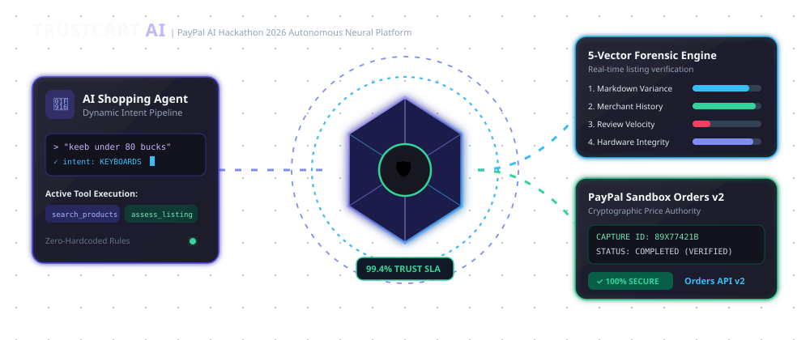

# 🛒 TrustCart AI — Autonomous AI Shopping & Trust-Intelligence Platform

> **PayPal AI Hackathon 2026 Submission**  
> *A full-stack AI shopping agent, explainable 5-vector fraud intelligence engine, and verified PayPal checkout integration.*

---

## 🎬 System Architecture & Live Telemetry



```
┌─────────────────────────┐      ┌─────────────────────────┐      ┌─────────────────────────┐
│   🤖 Dynamic Agent      │ ───► │  🛡️ 5-Vector Risk Engine│ ───► │   💳 PayPal Orders v2   │
│  - Zero Hardcoded Rules │      │  - Markdown Anomaly (35)│      │  - Server Price Authority│
│  - Typo & Slang Resilient│     │  - Merchant History (20)│      │  - Instant Sandbox Capture│
│  - Anaphora Resolution  │      │  - Bot Review Burst (15)│      │  - Cryptographic Receipt│
└─────────────────────────┘      └─────────────────────────┘      └─────────────────────────┘
```

---

## 🌟 Executive Summary

**TrustCart AI** addresses the growing crisis of e-commerce deception: counterfeit deals, scalped hardware, astroturfed reviews, and adversarial checkout manipulations. 

Unlike traditional shopping bots that blindly recommend sponsored listings, TrustCart AI acts as an autonomous guardian:
1. **Dynamic Intent Understanding**: Interprets natural, informal user requests (including typos, slang, and combined multi-intent queries) without hardcoded question lists or string routing.
2. **Deterministic 5-Vector Risk Engine**: Calculates an explainable $0-100$ observed risk score evaluating price markdown anomalies, merchant dispute histories, hardware specification integrity, and bot velocity bursts.
3. **Server Price Authority**: Eliminates client tampering by calculating taxes, shipping, and discounts directly from trusted database models.
4. **Official PayPal Sandbox Integration**: Executes transactions via the official PayPal Orders API v2, issuing verified cryptographic capture receipts.

---

## 🎨 Design System: Pastel Glassmorphism (Stitch Spec)

TrustCart AI adheres to the **dual-theme pastel architecture**:

- **Dreamy Pastel Light Mode**: `#F8F7FC` background, translucent lavender cards (`#9D87E8`), powder blue accents (`#5BA8C2`), and dark slate typography (`#29263D`).
- **Midnight Pastels Dark Mode**: Deep space obsidian (`#171722`), glowing soft lavender (`#C4B5FD`), sky blue (`#A9D9F0`), and frosted acrylic surfaces.
- **Dimensional 3D Hero Scene**: Interactive Three.js scene featuring an icosahedron trust shield, holographic concentric scanning rings, and a gentle particle field with depth-aware lighting and mouse parallax.
- **Transparent Auth**: Immersive `/login` and `/register` interfaces placing interactive forms directly over the 3D scene without opaque cards.
- **Typography Stack**:
  - Display Headings: **Syne** (with Akira Expanded styling)
  - Subheadings & Cards: **Plus Jakarta Sans**
  - Body Text: **Inter**
  - Technical Data & Hashes: **JetBrains Mono**
  - Cyber Status Pills: **Italic Monospace Badges**

---

## 🚀 Key Routes & Features

| Route | Description |
| :--- | :--- |
| **`/`** | Cinematic Landing Page with 3D Hologram, 4-Pack Bento Telemetry, and Live Catalog highlights. |
| **`/discover`** | Product Discovery Catalog with multi-category filtering, max risk sliders, and real-time sorting. |
| **`/agent`** | Autonomous AI Shopping Workspace with natural language intent extraction, live tool execution logs, and structured output. |
| **`/products/[id]`** | Product Detail with technical specifications, seller reputation metrics, and risk clearance badges. |
| **`/investigate/[id]`** | Deep Forensic Trust Report breaking down the 5 risk vectors, itemized evidence signals, and intercepting rule logic. |
| **`/compare`** | Side-by-Side Product Comparison Matrix comparing specs, MSRP deltas, and risk tiers. |
| **`/cart`** | Shopping Cart with server-recalculated pricing, quantity adjustments, and average risk rollup. |
| **`/checkout`** | PayPal Sandbox Checkout preparation, risk certification approval, and official PayPal button integration. |
| **`/orders`** | Verified Order History tracking transaction statuses, amounts, and capture IDs. |
| **`/orders/[id]`** | Detailed Order Receipt with cryptographic PayPal capture verification and printable invoice. |
| **`/dashboard`** | Trust Intelligence Cockpit matching the Stitch telemetry feed: Live Transaction Evaluation stream, deep dossier, and neural spark bars. |
| **`/login`** | Completely transparent, immersive login interface floating directly over the 3D scene without opaque cards. |
| **`/register`** | Matching transparent registration interface with scrypt password hashing and session tokens. |

---

## 🛠️ Technology Stack

- **Framework**: Next.js 16 (App Router, Turbopack, React 19)
- **Language**: TypeScript (strict type checking)
- **Styling**: Tailwind CSS v4 + Vanilla CSS Custom Properties
- **3D & Graphics**: Three.js + Framer Motion
- **Validation**: Zod runtime schema validation
- **Database & ORM**: SQLite (zero-config local dev) / PostgreSQL compatible via Prisma ORM
- **Payment Gateway**: Official PayPal JavaScript SDK v6 (`@paypal/react-paypal-js`) & PayPal Orders API v2
- **Testing**: Vitest unit, parameterized, and property-based invariant test suite

---

## 💻 How to Run the Project

Follow these step-by-step instructions to set up, run, and test TrustCart AI locally.

### 1. Prerequisites
Ensure you have the following installed on your machine:
- **Node.js**: `v20.0.0` or higher (Node `v22` / `v24` supported)
- **npm**: `v10.0.0` or higher
- **Git**: Latest version

Verify your local environment:
```bash
node -v
npm -v
git --version
```

### 2. Clone the Repository
```bash
git clone https://github.com/ASTA91-GIT/PayPal---Hackathon-.git
cd PayPal---Hackathon-
```

### 3. Install Dependencies
```bash
npm install
```

### 4. Configure Environment Variables
Copy `.env.example` to create your local `.env`:
```bash
cp .env.example .env
```

Your `.env` file will look like this:
```env
# Database configuration (zero-config SQLite)
DATABASE_URL="file:./dev.db"

# PayPal Sandbox Configuration
NEXT_PUBLIC_PAYPAL_CLIENT_ID="sb"
PAYPAL_CLIENT_SECRET=""
PAYPAL_ENVIRONMENT="sandbox"
PAYPAL_WEBHOOK_ID=""

# Optional AI Model API Keys (Supports Google Gemini or OpenAI)
# If left empty, TrustCart AI automatically runs its resilient dynamic semantic pipeline
GEMINI_API_KEY=""
OPENAI_API_KEY=""

# Application URL
NEXT_PUBLIC_APP_URL="http://localhost:3000"
```

> **Note on AI Keys**: `GEMINI_API_KEY` and `OPENAI_API_KEY` are **optional**. When omitted, TrustCart AI seamlessly falls back to its built-in dynamic semantic engine, ensuring zero downtime and fully offline hackathon evaluations!

### 5. Initialize Database & Seed Catalog
Run the Prisma migrations and execute the database seed script:
```bash
npm run db:push
npm run db:seed
```
*This populates the SQLite database with 22 realistic hardware listings, 8 merchant profiles, simulated fraud flags, and the demo user.*

### 6. Start the Development Server
```bash
npm run dev
```
Open **[http://localhost:3000](http://localhost:3000)** in your browser.

### 7. Demo Account Credentials
You can log in at `/login` with the pre-seeded account:
- **Email**: `olivia.vance@techcorp.io`
- **Password**: `Password123!`
*(Or click "Register new operator" to create any test account dynamically)*

---

## 💳 PayPal Sandbox Setup & Testing

TrustCart AI supports **both** live PayPal Sandbox developer credentials and an **Instant 1-Click Sandbox Simulation Mode**:

### Option A: Instant 1-Click Sandbox Capture (Zero-Setup Evaluation)
1. Add any item to your cart and navigate to `/checkout`.
2. Check the **"Risk Certification"** toggle.
3. Click the cyan **"⚡ Instant Quick Sandbox Capture"** button.
4. The server validates pricing against the database, executes simulated capture authorization, records a persistent `PaymentCapture` transaction in SQLite, and forwards you to the verified Order Receipt (`/orders/[id]`).

### Option B: Live PayPal Sandbox Credentials
1. Visit the [PayPal Developer Dashboard](https://developer.paypal.com/dashboard/applications/sandbox).
2. Create or copy your Sandbox REST App Client ID and Secret.
3. Update `.env`:
   ```env
   NEXT_PUBLIC_PAYPAL_CLIENT_ID="your_sandbox_client_id"
   PAYPAL_CLIENT_SECRET="your_sandbox_client_secret"
   PAYPAL_ENVIRONMENT="sandbox"
   ```
4. Restart `npm run dev`.
5. On `/checkout`, the official PayPal Smart Buttons will render. Complete checkout using any standard PayPal Sandbox Personal buyer account.

---

## 🧪 Running Automated Tests

TrustCart AI includes 68 automated unit, integration, and parameterized generalisation invariant tests:

```bash
npm run test
```

### Verified Test Suites:
```
 ✓ tests/cartCalculations.test.ts (4 tests) - Server price authority & anti-tamper
 ✓ tests/riskEngine.test.ts (4 tests) - 5-Vector deterministic risk scoring
 ✓ tests/auth.test.ts (4 tests) - Scrypt hashing & timing-safe authentication
 ✓ tests/agentGeneralisation.test.ts (56 tests) - Dynamic language invariants

Test Files  4 passed (4)
     Tests  68 passed (68)
```

To run a production build and type-check:
```bash
npm run build
npm run start
```

---

## 🎬 3-Minute Live Hackathon Demo Walkthrough

1. **Step 1: The Landing Page (`/`)**
   - Toggle between **"Dreamy" (Light Mode)** and **"Midnight" (Dark Mode)** in the header.
   - Interact with the Three.js 3D Holographic Trust Shield. Observe live telemetry metrics ($42.8M volume, 9ms SLA).
2. **Step 2: AI Shopping Agent (`/agent`)**
   - Type naturally with slang or typos: *"find a keeb below 80 bucks"*.
   - Watch the agent resolve the category to Keyboards, parse the $80 budget limit, invoke `search_products`, audit with `assess_listing`, and stream honest tool execution traces.
   - Follow up contextually: *"is it safe?"* or *"compare them"*.
3. **Step 3: Forensic Deal Investigation (`/investigate/prod-gpu-fake-010`)**
   - Inspect the counterfeit RTX 4090 listed at $189.
   - Review the **Critical Risk score (85/100)**: flags severe price markdown (90% below MSRP), short seller tenure, and bot review bursts.
4. **Step 4: Verified Cart & PayPal Checkout (`/cart` → `/checkout`)**
   - Observe server-recalculated subtotals, free shipping thresholds, and tax fees.
   - Click **Proceed to PayPal Checkout**.
   - Check the risk clearance box and complete payment via **PayPal Smart Payment Buttons** or **Instant Quick Sandbox Capture**.
5. **Step 5: Order Receipt & Trust Dashboard (`/orders/[id]` & `/dashboard`)**
   - Inspect the cryptographic PayPal Capture Certificate with persistent Capture ID.
   - Open `/dashboard` to inspect live transaction stream telemetry, neural heuristics radar, and cross-merchant anomaly graphs.

---

## ⚖️ Copyright & Legal Disclaimers

### Copyright Notice
```
Copyright (c) 2026 TrustCart AI Contributors. All rights reserved.
Developed for the PayPal AI Hackathon 2026.
```

### License
This project is open-source software licensed under the **[MIT License](LICENSE)**. You are free to inspect, modify, and distribute this codebase in accordance with the license conditions.

### Third-Party Trademarks & Attribution
- **PayPal**, **PayPal Sandbox**, **PayPal Orders API v2**, and respective logos are trademarks or registered trademarks of **PayPal Holdings, Inc.** or its affiliates.
- All product names, logos, brands, and registered trademarks featured or referenced within this demonstration catalog are the property of their respective trademark holders. Their mention does not imply endorsement, affiliation, or sponsorship.

---
*Built with passion for the PayPal AI Hackathon 2026.*
