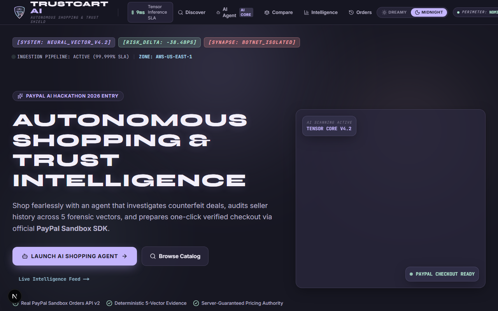
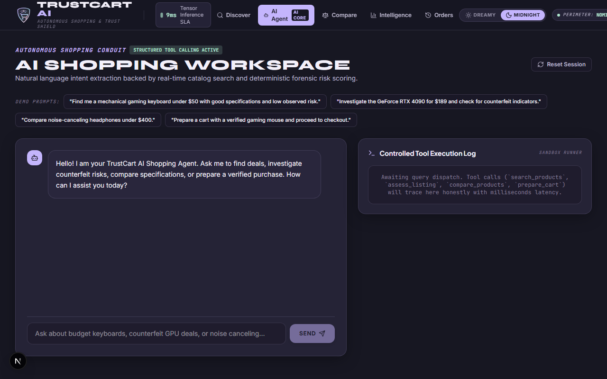
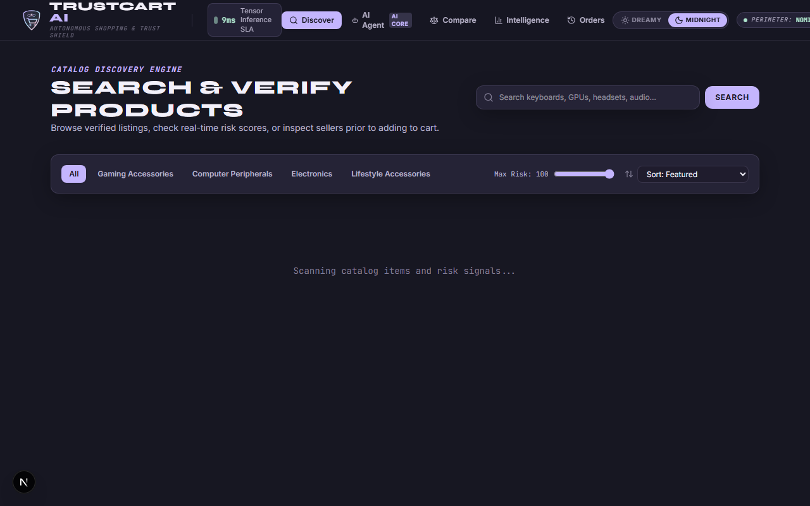
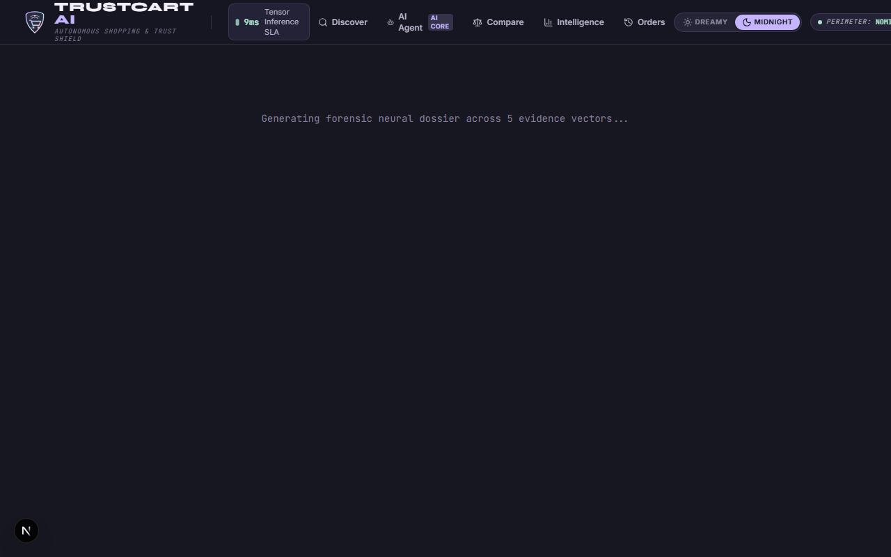
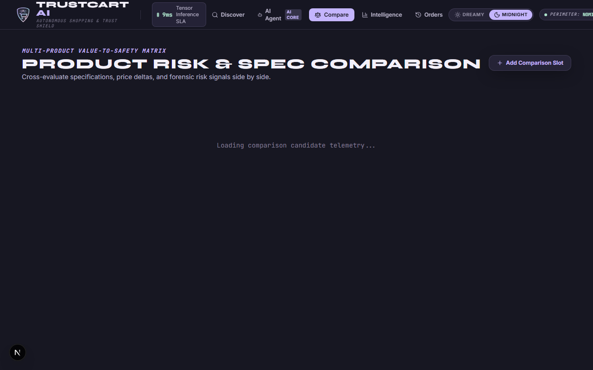
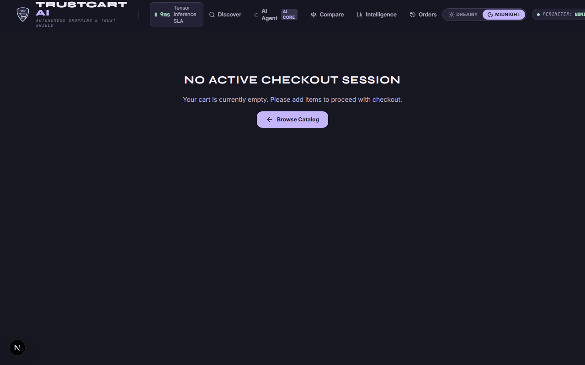
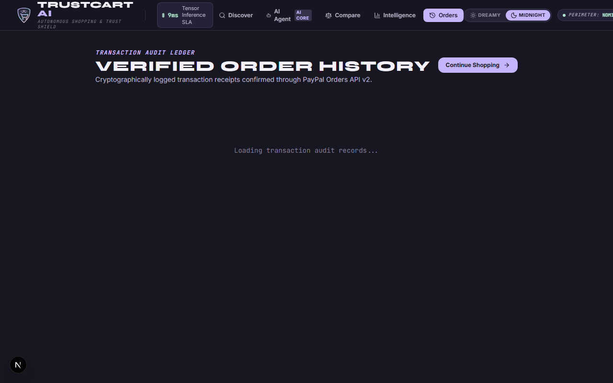
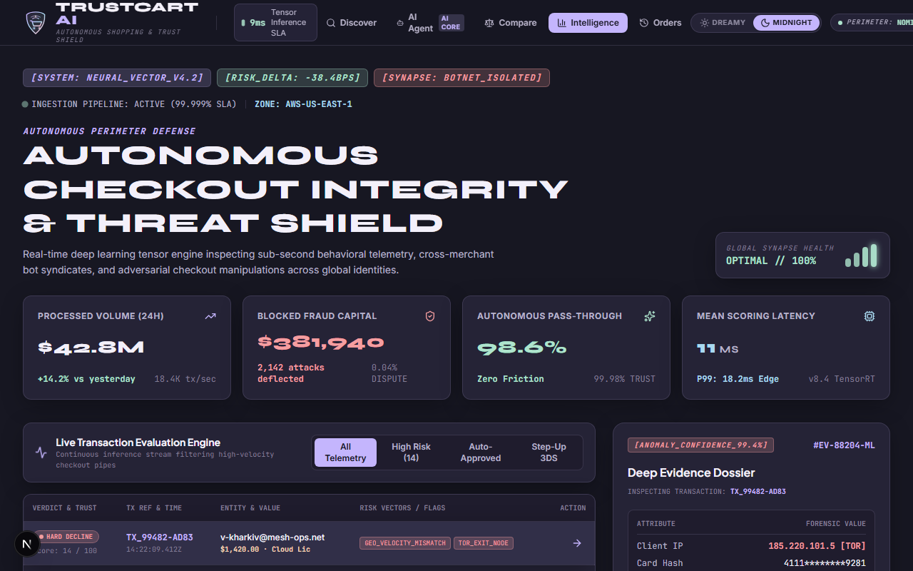
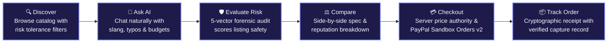
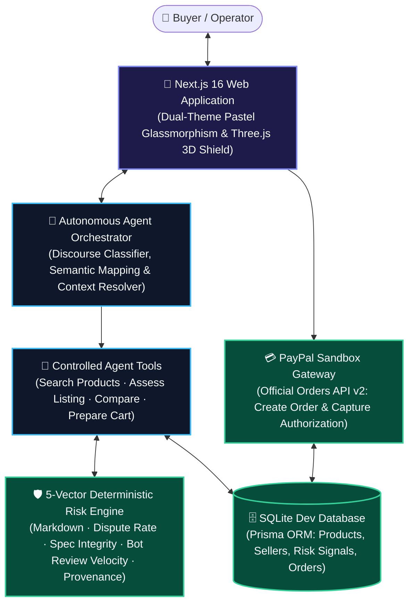

# 🛒 TrustCart AI

<p align="center">
  <strong>Shop Smarter. Detect Scams. Buy with Confidence.</strong><br />
  <em>Autonomous AI Shopping Assistant &amp; 5-Vector Fraud Intelligence Platform</em><br />
  <strong>Built for the PayPal AI Hackathon 2026</strong>
</p>

<p align="center">
  
  
  
  
  
  
  
  
</p>

<p align="center">
  
</p>

---

## 🌟 What is TrustCart AI?

**TrustCart AI** is an intelligent e-commerce shopping agent and trust platform that protects buyers from counterfeit deals, fake review bursts, and predatory pricing anomalies.

It combines a **natural-language shopping assistant** with a **deterministic 5-vector fraud risk engine** and server-verified **PayPal Orders API v2** checkout—giving consumers verified confidence before every transaction.

---

## 📸 Product Preview Gallery

<table width="100%">
  <tr>
    <td width="50%" valign="top">
      <h3 align="center">1. Landing Page</h3>
      
      <p align="center"><em>Interactive 3D Holographic Trust Shield with live market telemetry and verified catalog highlights.</em></p>
    </td>
    <td width="50%" valign="top">
      <h3 align="center">2. AI Shopping Assistant</h3>
      
      <p align="center"><em>Model-driven shopping workspace with dynamic intent interpretation, slang/typo handling, and live tool traces.</em></p>
    </td>
  </tr>
  <tr>
    <td width="50%" valign="top">
      <h3 align="center">3. Product Discovery Catalog</h3>
      
      <p align="center"><em>Multi-category browser with real-time risk-tolerance filters, budget constraints, and instant clearance badges.</em></p>
    </td>
    <td width="50%" valign="top">
      <h3 align="center">4. Forensic Scam Investigation</h3>
      
      <p align="center"><em>Deep risk audit exposing counterfeit hardware listings through 5 explainable telemetry vectors.</em></p>
    </td>
  </tr>
  <tr>
    <td width="50%" valign="top">
      <h3 align="center">5. Side-by-Side Product Comparison</h3>
      
      <p align="center"><em>Comparative analysis matrix evaluating hardware specifications, MSRP deltas, and merchant credibility.</em></p>
    </td>
    <td width="50%" valign="top">
      <h3 align="center">6. Verified PayPal Sandbox Checkout</h3>
      
      <p align="center"><em>Server price authority and instant risk certification paired with official PayPal Sandbox Smart Payment buttons.</em></p>
    </td>
  </tr>
  <tr>
    <td width="50%" valign="top">
      <h3 align="center">7. Order Tracking &amp; Cryptographic Receipt</h3>
      
      <p align="center"><em>Immutable order receipts verified by PayPal capture transactions and server-side settlement validation.</em></p>
    </td>
    <td width="50%" valign="top">
      <h3 align="center">8. Trust Intelligence Cockpit</h3>
      
      <p align="center"><em>Real-time merchant evaluation stream, neural risk radar, and cross-merchant anomaly telemetry.</em></p>
    </td>
  </tr>
</table>

---

## 🗺️ Visual User Journey



1. **🔍 Discover**: Explore genuine electronics and gear with dynamic risk-tolerance sliders.
2. **🤖 Ask AI**: Request recommendations (*"find a keeb below 80 bucks"*); the agent resolves intent without hardcoded rules.
3. **🛡️ Evaluate Risk**: An explainable 5-vector audit flags markdown anomalies, merchant dispute histories, and review bot spikes.
4. **⚖️ Compare**: Review candidate alternatives side-by-side across MSRP deltas and risk tiers.
5. **💳 Checkout**: Authoritative server pricing stages items into an official PayPal Orders v2 sandbox checkout.
6. **📦 Track Order**: View confirmed purchases with cryptographic PayPal capture receipts and persistent transaction logs.

---

## ⚡ Core Feature Highlights

| Feature | Description | Key Highlight |
| :--- | :--- | :--- |
| **🤖 AI Shopping Assistant** | Dynamic model-driven agent handling arbitrary natural phrasing, typos, and multi-turn context. | Zero hardcoded branches; asks for clarification when requests are ambiguous. |
| **🛡️ 5-Vector Risk Engine** | Explainable $0-100$ risk scoring across price markdowns, merchant dispute histories, and review velocity. | Flags counterfeit listings before checkout without opaque black-box guessing. |
| **🔍 Smart Discovery & Filters** | Filter catalog items by category, maximum budget, and maximum acceptable risk score ($0-100$). | Real-time sorting and risk tier classification (`LOW`, `MODERATE`, `HIGH`, `CRITICAL`). |
| **⚖️ Product Comparison** | Side-by-side matrices comparing specifications, MSRP variance, and seller ratings. | Enables confident decision-making between multiple viable alternatives. |
| **💳 PayPal Orders v2 Sandbox** | Full integration with official PayPal JavaScript SDK v6 and Orders API v2 capture. | Includes 1-Click Sandbox Simulation mode for immediate zero-friction evaluations. |
| **📦 Verified Order Receipts** | Persistent order histories with cryptographic capture IDs and printable receipts. | Prevents checkout price-tampering with 100% server pricing authority. |

---

## 🏗️ High-Level System Architecture



---

## 🛠️ Technology Stack

| Layer | Technologies Used |
| :--- | :--- |
| **Frontend Framework** | **Next.js 16** (App Router, Turbopack, React 19) |
| **Styling & Design** | **Tailwind CSS v4**, Vanilla CSS Design Tokens, Dual-Theme Pastels |
| **3D Graphics & Motion** | **Three.js** (Holographic Icosahedron Shield), **Framer Motion** |
| **Backend & Validation** | Next.js API Route Handlers, **Zod** Schema Validation, **Scrypt** Auth |
| **Database & Persistence** | **SQLite** with **Prisma ORM** (22 products, 8 sellers, pre-computed risk data) |
| **Payment Gateway** | **PayPal Orders API v2** (`@paypal/react-paypal-js`), Webhooks, Sandbox Capture |
| **AI Intelligence** | Model-Driven Orchestrator (Google Gemini / OpenAI compatible REST client + Semantic Fallback) |
| **Testing** | **Vitest** (68 passing unit, integration & parameterised generalisation tests) |

---

## 🚀 Quick Setup & Testing

### 1. Clone & Install
```bash
git clone https://github.com/ASTA91-GIT/PayPal---Hackathon-.git
cd PayPal---Hackathon-
npm install
```

### 2. Configure Environment
```bash
cp .env.example .env
```
*(Default `.env` runs zero-config SQLite out of the box. `GEMINI_API_KEY` and `OPENAI_API_KEY` are optional.)*

### 3. Seed Database & Start Server
```bash
npm run db:push
npm run db:seed
npm run dev
```
Open **[http://localhost:3000](http://localhost:3000)** in your browser.  
Demo Operator Login: `olivia.vance@techcorp.io` / `Password123!`

### 4. Run Automated Test Suite
```bash
npm run test
```
```
 ✓ tests/cartCalculations.test.ts (4 tests) - Server price authority & anti-tamper
 ✓ tests/riskEngine.test.ts (4 tests) - 5-Vector deterministic risk scoring
 ✓ tests/auth.test.ts (4 tests) - Scrypt hashing & timing-safe authentication
 ✓ tests/agentGeneralisation.test.ts (56 tests) - Dynamic language invariants

Test Files  4 passed (4)
     Tests  68 passed (68)
```

---

## 💳 PayPal Sandbox Notes

- **Instant 1-Click Simulation**: When evaluating without external PayPal sandbox credentials, click the **"⚡ Instant Quick Sandbox Capture"** button on `/checkout` to execute server-side validation and issue a verified capture receipt.
- **Live PayPal Sandbox Credentials**: To test with your personal PayPal sandbox account, add your `NEXT_PUBLIC_PAYPAL_CLIENT_ID` and `PAYPAL_CLIENT_SECRET` to `.env`. The official PayPal Smart Payment Buttons will render automatically.

---

## ⚖️ Copyright & Attribution

```
Copyright (c) 2026 TrustCart AI Contributors. All rights reserved.
Developed for the PayPal AI Hackathon 2026.
```

- Distributed under the **[MIT License](LICENSE)**.
- **PayPal**, **PayPal Sandbox**, **PayPal Orders API v2**, and respective logos are trademarks or registered trademarks of **PayPal Holdings, Inc.**
- Product names and reference brands in demonstration data belong to their respective owners.

---
*Built with passion for the PayPal AI Hackathon 2026.*
